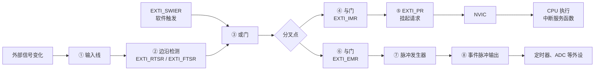

# EXTI 外部中断与事件控制器作业

## 一、复述 EXTI 功能框图各编号电路的作用

| 编号 | 电路或器件 | 作用 |
|---|---|---|
| ① | 输入线 | 接收 GPIO 或其他外设送来的电平变化信号，是中断线路和事件线路的共同输入。GPIO 可以通过 AFIO_EXTICR 寄存器选择具体连接到哪一条 EXTI 输入线。 |
| ② | 边沿检测电路 | 根据 EXTI_RTSR 和 EXTI_FTSR 两个触发选择寄存器的设置，检测上升沿、下降沿或双边沿。检测到符合设置的边沿时输出有效信号，没有检测到相应边沿时输出无效信号。 |
| ③ | 或门 | 将②号边沿检测电路的输出与 EXTI_SWIER 软件中断事件寄存器的触发信号进行合并。只要其中任意一路有效，就能产生一次中断或事件请求，因此也可以通过软件人为触发。 |
| ④ | 与门（中断屏蔽） | 用于控制中断线路是否允许通过，并由 EXTI_IMR 中断屏蔽寄存器控制。当对应位为 1 时允许中断请求通过，为 0 时封锁中断请求，因此可以单独控制某一输入线是否产生中断。 |
| ⑤ | 挂起请求电路 | 将④号与门送来的中断请求锁存到 EXTI_PR 挂起寄存器中，再把中断请求送往 NVIC。CPU 响应后进入中断服务函数，程序通常需要清除相应的挂起位，以避免重复响应。 |
| ⑥ | 与门（事件屏蔽） | 用于控制事件线路是否允许通过，并由 EXTI_EMR 事件屏蔽寄存器控制。当对应位为 1 时允许事件信号通过，为 0 时封锁事件信号，因此事件和中断可以分别独立控制。 |
| ⑦ | 脉冲发生器 | 将⑥号与门输出的有效信号转换成脉冲信号。这样事件线路最终输出的是瞬时触发脉冲，而不是一直保持的高电平。 |
| ⑧ | 事件脉冲输出 | 将⑦号脉冲发生器产生的脉冲送给定时器、ADC 等其他外设，用于直接触发硬件动作。事件线路不进入 CPU 中断服务函数，属于硬件级触发方式。 |

## 二、中断线路与事件线路的分叉点及区别

中断线路与事件线路的分叉点在 **③号或门的输出端**。在③号或门之前，两条线路共用①号输入线和②号边沿检测电路；经过③号或门后，信号分别进入中断线路和事件线路。

两条线路的主要区别如下：

| 比较项目 | 中断线路 | 事件线路 |
|---|---|---|
| 屏蔽控制 | 由 EXTI_IMR 中断屏蔽寄存器控制 | 由 EXTI_EMR 事件屏蔽寄存器控制 |
| 控制特点 | 中断可以单独开启或关闭 | 事件可以单独开启或关闭，与中断互不影响 |
| 信号路径 | ④号与门 → ⑤号 EXTI_PR 挂起请求 → NVIC | ⑥号与门 → ⑦号脉冲发生器 → ⑧号事件脉冲输出 |
| 最终去向 | 送往 NVIC，由 CPU 执行中断服务函数 | 直接送到定时器、ADC 等外设 |
| 响应层次 | 属于软件层面的响应，占用 CPU 中断响应时间 | 属于硬件层面的响应，不占用 CPU 中断响应时间 |
| 主要用途 | 通知 CPU 处理程序逻辑 | 直接触发其他硬件外设，例如 ADC 或定时器 |

## 三、为什么推荐边沿触发而不是电平触发

1. 电平触发时，只要输入一直保持有效电平，请求就会持续存在。如果中断服务函数返回前没有及时撤销该电平，CPU 可能立即再次进入同一个中断，造成中断反复重入，甚至使主程序长期无法运行。边沿触发通常只需要处理一次变化，CPU 可以及时返回主程序，实时性较好，也不会因为信号长期有效而反复进入中断。

